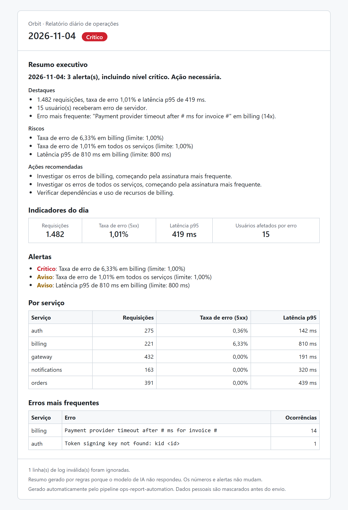
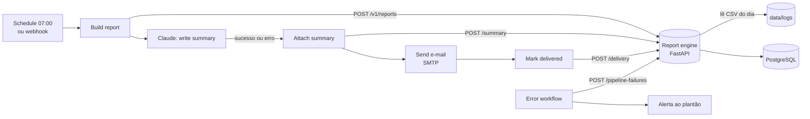

# Ops Report Automation


Pipeline que **substitui o relatório diário de operações feito à mão**: todo dia às 07:00 o
**n8n** lê os logs do dia anterior, um serviço Python calcula métricas e detecta anomalias, o
**Claude** escreve o resumo executivo e o relatório chega por e-mail. Se algo falha, o plantão
recebe um alerta.

> Logs CSV do dia → métricas (volume, taxa de erro, p95, usuários afetados) → anomalias contra
> SLO e contra a média dos últimos 7 dias → resumo por IA (ou por regras, se a IA falhar) →
> e-mail HTML → registro de entrega e métricas de resultado.

<p align="center">
  
  <br>
  <sub>E-mail gerado pelo pipeline no dia do incidente simulado (04/11): billing com 6,33% de erro.</sub>
</p>

---

## O problema

Montar o relatório diário de operações na mão significa exportar logs, abrir planilha, calcular
taxa de erro e latência por serviço, comparar com a semana, procurar os erros que mais se
repetem e escrever um resumo para a gestão. Além de tomar tempo de alguém sênior, o trabalho
atrasa nos dias de incidente, que são justamente os dias em que o relatório mais importa.

## Resultados medidos

Execução real da stack (Docker Compose + n8n 2.46.6) sobre 9 dias de logs sintéticos
([`data/logs/`](data/logs/), cerca de 1.300 eventos/dia, com dois incidentes injetados):

| Indicador | Resultado |
|---|---|
| Relatórios entregues | **9 de 9** dias |
| Tempo do pipeline (geração → e-mail entregue) | **7,9 s** em média (a 1ª execução após o boot leva até ~35 s) |
| Cálculo de métricas e anomalias (1.500 eventos) | ~170 ms |
| Incidentes detectados | **2 de 2**: billing com 6,3% de erro em 04/11 (**CRÍTICO**) e orders com p95 de 1.869 ms em 06/11 (**ATENÇÃO**) |
| Falsos alarmes nos 7 dias normais | **0** |
| Falha forçada (dia sem logs) | alerta entregue ao plantão, contabilizado em `pipelineFailures` |
| Dados pessoais no e-mail e no banco | **0** (e-mail e CPF dos logs viram `[EMAIL]` e `[CPF]`) |

Esses números vêm de `GET /v1/metrics/summary` e da caixa do Mailpit depois de rodar
`scripts/backfill.sh`. O CI repete o cenário a cada push (job `e2e`).

### Horas economizadas

O serviço calcula `horas economizadas = relatórios entregues × MANUAL_REPORT_MINUTES / 60`.
Com a **hipótese** de 90 minutos por relatório manual, os 9 dias acima equivalem a 13,5 h, ou
**~45 h/mês** em operação diária. Cronometre o processo manual da sua equipe e ajuste
`MANUAL_REPORT_MINUTES` antes de divulgar o número.

### Resumo por IA

A tabela acima foi gerada **sem chave da Anthropic**. A chamada ao Claude falha e o pipeline usa
o resumo por regras, o que demonstra o fallback. Com `ANTHROPIC_API_KEY` no `.env`, o resumo
passa a ser escrito pelo Claude e o custo por relatório aparece em `totalLlmCostUsd`.

| Modo | Custo/relatório | Observação |
|---|---|---|
| Regras (fallback) | US$ 0 | Medido acima |
| Claude (`claude-opus-5-5`, effort `low`) | _rode com sua chave_ | Aparece em `/v1/metrics/summary` |

---

## Arquitetura



**Divisão de responsabilidades**

| n8n (orquestração) | Serviço Python (regras) |
|---|---|
| Agenda (cron 07:00, fuso America/Sao_Paulo) e webhook sob demanda | Leitura do CSV, mascaramento LGPD, métricas |
| Credenciais criptografadas (Anthropic, SMTP, chave do serviço) | Detecção de anomalias (SLO e média de 7 dias) |
| Chamada HTTP ao Claude, com retry | Prompt versionado e JSON Schema da resposta |
| Envio do e-mail, com retry | Validação da resposta do Claude e fallback por regras |
| Workflow de erro com alerta | HTML do e-mail (i18n pt-BR/en), auditoria e métricas |

O n8n guarda os segredos e cuida da integração. As regras ficam em código testado.

```
n8n/workflows/        # Workflows versionados no Git (importados no boot)
n8n/init/             # Bootstrap: credenciais a partir do .env + publicação dos workflows
service/src/report_engine/
├── domain/           # Métricas, anomalias, ciclo de vida do relatório. Sem framework.
├── application/      # Casos de uso e portas.
├── infrastructure/   # CSV, Claude (request/parse), e-mail, SQLAlchemy, i18n.
└── api/              # FastAPI, RFC 7807, autenticação por chave.
service/prompts/      # Prompt versionado + CHANGELOG.
data/logs/            # Logs de exemplo (gerados por service/scripts/generate_sample_logs.py).
```

### Decisões de projeto

| Decisão | Por quê |
|---|---|
| **Código decide, IA escreve** | O status do dia (verde/amarelo/vermelho) sai de regras determinísticas. O Claude recebe esse status e não pode contradizê-lo. |
| **Fallback por regras** | Se o Claude falhar, recusar ou devolver JSON inválido, o relatório sai mesmo assim (`summarySource = FALLBACK`). Um relatório diário não pode depender de um único fornecedor. |
| **Claude só vê fatos agregados** | Nada de log bruto: só números, anomalias e assinaturas de erro já mascaradas. Menos custo, menos risco LGPD, menos alucinação. |
| **Prompt e schema no serviço** | O n8n só repassa o corpo da requisição. Prompt e JSON Schema ficam versionados e testados no repositório. |
| **Proteção contra amostra pequena** | Alerta de taxa de erro exige ≥ 50 requisições e ≥ 5 erros. Sem isso, 1 erro em 60 requisições já daria "1,7%" e um falso alarme. |
| **Idempotência** | Rodar de novo o mesmo dia regenera o relatório até ele ser entregue. Depois disso, `409 REPORT_ALREADY_DELIVERED`. O lock otimista (`rowversion`) impede duas execuções simultâneas de se sobrescreverem. |
| **Workflows como código** | JSON no Git, importado no boot, com **testes de contrato** que validam nós referenciados, rotas existentes no serviço e ausência de segredos. |

---

## Engenharia de prompt

O prompt está em [`service/prompts/daily-report/v1.md`](service/prompts/daily-report/v1.md):

1. **Leitor e objetivo**: gestores lendo no celular, decidindo em um minuto se há ação.
2. **Fronteira de dados**: só vale o que está em `<facts>`. As assinaturas de erro vêm de logs e são tratadas como dado, nunca como instrução. O log de 07/11 contém uma tentativa de prompt injection para testar isso.
3. **Status imposto**: o modelo não pode contradizer o `health` calculado pelas regras.
4. **Formato**: `headline`, `highlights`, `risks`, `actions`, garantidos por **structured outputs** (JSON Schema) e revalidados no serviço (tamanho, quantidade de itens, novo mascaramento).
5. **Estilo**: idioma configurável, sem Markdown, percentuais com duas casas.

O [`CHANGELOG`](service/prompts/CHANGELOG.md) define como comparar uma futura v2.

## Segurança e LGPD

- **Mascaramento na leitura**: e-mail, CPF, CNPJ, telefone, cartão e placa viram `[EMAIL]`, `[CPF]` etc. antes de qualquer cálculo. A coluna `user_email` só serve para contar usuários afetados (pseudonimizada em memória, nunca persistida).
- **Minimização**: o Claude, o banco e o e-mail só recebem agregados e assinaturas de erro mascaradas.
- **Segredos**: só no `.env` (fora do Git) e nas credenciais criptografadas do n8n (`N8N_ENCRYPTION_KEY`). O workflow não acessa variáveis de ambiente (`N8N_BLOCK_ENV_ACCESS_IN_NODE=true`).
- **Autenticação negando por padrão**: o serviço e o webhook exigem `X-API-Key`. Sem chave configurada, ninguém entra.
- **Portas só em `127.0.0.1`** no Compose.
- **Auditoria**: `createdby`/`updatedby` vêm do rótulo da chave, e cada falha do pipeline fica registrada em `pipeline_failure`.
- **Logs JSON** com `correlationId` e mascaramento no formatter.

---

## Como rodar

Pré-requisitos: Docker Desktop (ou Docker Engine + Compose) e Git.

```bash
git clone https://github.com/Giulia-Castro/ops-report-automation.git
cd ops-report-automation
cp .env.example .env
```

Preencha no `.env` os três valores obrigatórios (`POSTGRES_PASSWORD`, `REPORT_ENGINE_API_KEY`,
`N8N_ENCRYPTION_KEY`). Para gerar cada um:

```bash
python -c "import secrets; print(secrets.token_urlsafe(32))"
```

```bash
docker compose up -d --build
```

Aguarde cerca de 1 minuto (o n8n publica os workflows no boot) e rode os 9 dias de exemplo:

```bash
bash scripts/backfill.sh 2026-10-30 2026-11-07
```

| O quê | Onde |
|---|---|
| E-mails enviados (Mailpit) | http://localhost:8025 |
| n8n (crie o usuário no primeiro acesso) | http://localhost:5678 |
| API do serviço (Swagger) | http://localhost:8000/docs |
| Métricas de resultado | `GET http://localhost:8000/v1/metrics/summary` com `X-API-Key` |

O HTML do e-mail mostrado no topo está em
[`docs/sample-report-2026-11-04.html`](docs/sample-report-2026-11-04.html).

### Com o Claude

Coloque `ANTHROPIC_API_KEY=<sua-chave>` no `.env` (crie em https://platform.claude.com) e
reaplique as credenciais:

```bash
docker compose up -d --force-recreate n8n-bootstrap n8n
```

### Em produção

- Troque o SMTP no `.env` (`SMTP_HOST`, `SMTP_PORT`, `SMTP_USER`, `SMTP_PASSWORD`, `SMTP_SECURE`) e as listas `REPORT_RECIPIENTS` / `ALERT_RECIPIENTS`.
- Aponte `./data/logs` para a pasta onde os logs diários chegam (montagem SFTP, sync de bucket etc.). O formato esperado está em [`service/scripts/generate_sample_logs.py`](service/scripts/generate_sample_logs.py).
- Coloque o n8n atrás de HTTPS e guarde o `N8N_ENCRYPTION_KEY` num cofre.

## Testes e qualidade

```bash
cd service
pip install -e ".[dev]"
pytest          # 79 testes, cobertura ~97% (mínimo 80%)
ruff check . && ruff format --check .
```

O CI ([`.github/workflows/ci.yml`](.github/workflows/ci.yml)) roda:

1. lint, testes unitários, de integração e **de contrato dos workflows n8n**, e migrations em PostgreSQL real;
2. **e2e**: sobe a stack inteira com Docker Compose, dispara o workflow pelo webhook do n8n, confere os e-mails no Mailpit e as métricas na API ([`scripts/e2e.sh`](scripts/e2e.sh)).

## Limitações e próximos passos

- Os logs são sintéticos. Com logs reais, recalibre os limites de alerta (`ERROR_RATE_*`, `P95_*`) a partir do histórico.
- O caminho com Claude foi testado com respostas simuladas (testes) e com falha real de autenticação (fallback). A chamada real depende da sua chave.
- Leitura de CSV em memória: atende dezenas de milhares de linhas por dia. Para milhões, mover a agregação para o banco ou para streaming.
- Próximo: dashboard (projeto 3) consumindo `/v1/metrics/summary` deste projeto e do [ticket-triage-agent](https://github.com/Giulia-Castro/ticket-triage-agent).

## Licença

[MIT](LICENSE)
